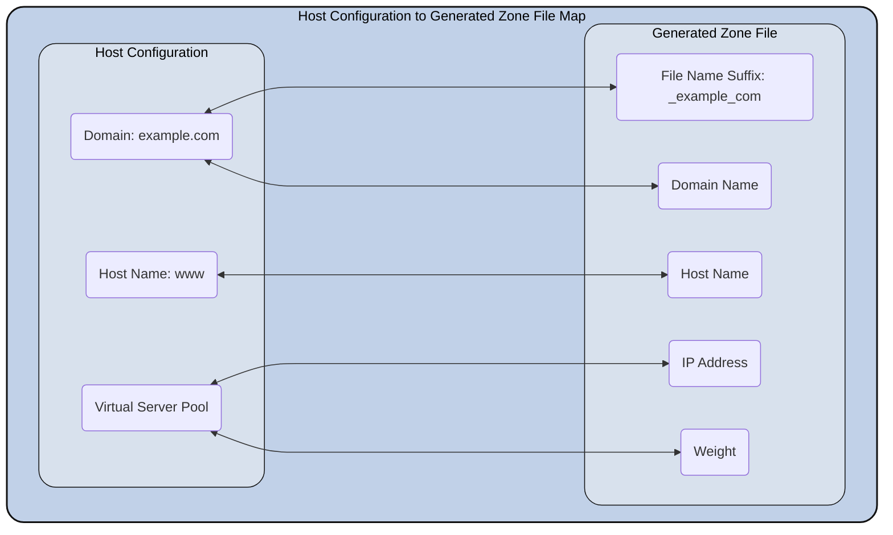

### Hosts

Host settings are used to form the zone configuration and resource records in the generated DNS zone used for global load balancing.

The Host Configuration to Generated Zone File Map shows how the host settings are mapped to zone settings and resource records. The domain is used in the generated zone configuration file name. The IP address and weight are derived from the virtual server pool.

**Host configuration and the generated DNS zone**



**Before you begin:**
- You must have created the global virtual server pools you want to use.
- You must have Read-Write permission for Global Load Balance settings.

After you have created a host configuration object, it can be used to form the zone and resource records in the generated DNS zone configuration.

> [!details]- ### Configure FAD-East
>
>### FAD-East
>**Username:** ```admin``` 
> 
>**Password:** ```fortinet```
> 
>1. Go to **Global Load Balance > GLB Configuration**
>2. Click **Create New**
>
>
> 
>3. Configure the **Name** ```fortiware-east```
>4. Configure the **Host Name** ```www```
>5. Configure the **Domain Name** ```fortiware.zzz.```
>6. Move the **DEFAULT_DNS_POLICY** to the left into the **Selected Items** box
>7. Configure **Default Feedback IPv4** to ```127.0.0.1```
>8. Toggle **FortiView** to **ON**
>
>
> 
>9. Click **Save**
>
> **To add a Virtual Server Pool:**
> 
>10. Click **Create New**
>
>
>
>11. Configure the **Name** ```dvwa-east-int```
>12. Select the **Virtual Server Pool** <mark>dvwa-east-int</mark>
>13. Select the **ISP** <mark>ISP-East</mark>
>
>
> 
>14. Click **Save**
>15. Repeat Steps 10-14 for ```dvwa-west-int```
>
>
> 
>16. Click **Save** again
>
>
>
>To see the dynamically generated zone file once the host section has been completed go to **Global Load Balance > Zone and DNS Security** and click on the **Zone** Tab.
> 
>

> [!details]- ### Configure FAD-West
>
>### FAD-West
>
>**Username:** ```admin```
> 
>**Password:** ```fortinet```
> 
>1. Go to **Global Load Balance > GLB Configuration**
>2. Click **Create New**
>
>
> 
>3. Configure the **Name** ```fortiware-west```
>4. Configure the **Host Name** ```www```
>5. Configure the **Domain Name** ```fortiware.zzz.```
>6. Move the **DEFAULT_DNS_POLICY** to the left into the **Selected Items** box
>7. Configure **Default Feedback IPv4** to ```127.0.0.1```
>8. Toggle **FortiView** to **ON**
>
>
> 
>9. Click **Save**
>
> **To add a Virtual Server Pool:**
> 
>10. Click **Create New**
>
>
>
>11. Configure the **Name** ```dvwa-east-int```
>12. Select the **Virtual Server Pool** <mark>dvwa-east-int</mark>
>13. Select the **ISP** <mark>ISP-East</mark>
>
>
> 
>14. Click **Save**
>15. Repeat Steps 10-14 for ```dvwa-west-int```
>
>
> 
>16. Click **Save** again
>
> 
>
>To see the dynamically generated zone file once the host section has been completed go to **Global Load Balance > Zone and DNS Security** and click on the **Zone** Tab.
> 
>

