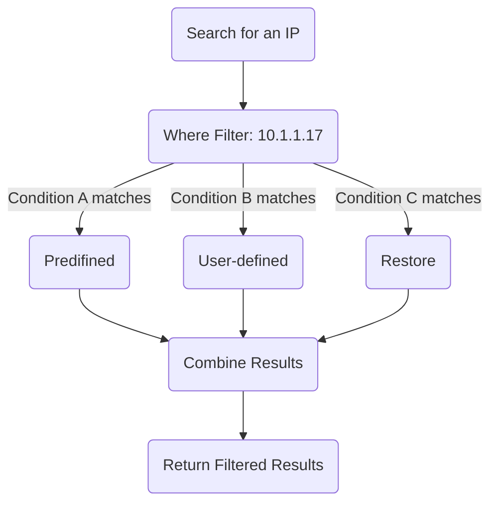

## ISP Address Books

ISP Address Books contain IP subnet addresses and associated province location settings for ISP links.

**The following policies use the ISP address book objects:**

- ISP routes
- LLB proximity routes
- LLB policies
- **GSLB data center configuration**

For this exercise we are most interested in using the ISP Address Book for returning certain A/AAAA records based on the clients location.


The province setting is used in GLB deployments in China to enable location awareness that is province-specific. For example, a user can be directed to a data center in specific location inside the country, such as Beijing or Guangdong, rather than simply China.

> [!details]- ### Configure FAD-East
>
>### FAD-East
>
>**From the evoke admin console, look for the External IP for FAD-East:**
>
>
>
>**Log in with:**
>
>**Username:** ```admin``` 
> 
>**Password:** ```fortinet```
>
>1. Go to **Shared Resources > Address**.
>2. Click the **ISP Address** tab.
>3. Click **Create New**. The ISP Address dialog opens.
>4. Configure the **Name** ```ISP-East```
>5. **Save**
>6. Click **Create New**. The **Address** dialog opens. 
>
>
>
>7. Configure 3 ISP Addresses to ```100.64.12.0/24```, ```100.64.11.0/24```, and ```100.64.10.0/24```.
>
>
>
>8. Click **Save**
>
>
>
>9. Click **Save** again
>10. Repeat steps 6 - 8 for ```ISP-West``` using subnets ```10.1.1.0/24```, ```10.1.2.0/14```, and ```10.1.3.0/24```.
>
>

> [!details]- ### Configure FAD-West
>
>### FAD-West
>
>**From the evoke admin console, look for the External IP for FAD-West:**
>
>
>
>**Log in with:**
>
>**Username:** ```admin``` 
> 
>**Password:** ```fortinet```
>
>1. Go to **Shared Resources > Address**.
>2. Click the **ISP Address** tab.
>3. Click **Create New**. The ISP Address dialog opens.
>4. Configure the **Name** ```ISP-West```
>5. **Save**
>6. Click **Create New**. The ISP Address dialog opens.
>
>
>
>7. Configure 3 ISP Addresses to ```10.1.1.0/24```, ```10.1.2.0/24```, and ```10.1.3.0/24```.
>
>
>
>8. Click **Save**
>
>
>
>9. Click **Save** again
>10. Repeat steps 6 - 8 for ```ISP-East``` using subnets ```100.64.12.0/24```, ```100.64.11.0/14```, and ```100.64.10.0/24```.
>
>
>

**ISP Address Object Configuration Guidelines**

| Settings         | Guidelines                                                                                                                                                                                                                                                                                              |
|------------------|---------------------------------------------------------------------------------------------------------------------------------------------------------------------------------------------------------------------------------------------------------------------------------------------------------|
| Name             | Configuration name. Valid characters are A-Z, a-z, 0-9, _, and -. No spaces. After you initially save the configuration, you cannot edit the name.                                                                                                                                                      |
| Address          | Address/mask notation specifying a subnet to add it to the address book entry.                                                                                                                                                                                                                          |
| Excluded Address | Address/mask notation specifying a subnet to be excluded from the address book entry. Create exclusions to predefined and restored address books only.<br>**Note:** This field applies to predefined and restored address books only; it is not applicable or available for user-defined address books. |

Select the associated province location. The configuration supports the following selections:

| Province |              |          |             |
|----------|--------------|----------|-------------|
|          | Anhui        | Henan    | Shanxi      |
|          | Beijing      | Hubai    | ( Tayuan )  |
|          | Chongqing    | Hunan    | Shanxi      |
|          | Fujian       | Jiangsu  | (Xian)      |
|          | Gansu        | Jiangxi  | Sichuan     |
|          | Guangdong    | Jilin    | Tianjin     |
|          | Guangxi      | Liaoning | Xiangjang   |
|          | Guizhou      | Ningxia  | Xizang      |
|          | Hainan       | Qinghai  | Yunnan      |
|          | Hebei        | Shandong | Zhejiang    |
|          | Heilongjiang | Shanghai | **Unknown** |

## Manageing ISP Address Books

**ISP Address Book types shows the three types of address book entries:**
- **Predefined** - Addresses and associated province location settings for China Mobile, China Telecom, and China Unicom. The IP subnet addresses in the predefined address books are not exposed in the user interface. The predefined package is provided to make it easier for you to configure a route when all you know and all you need to know is the name of the ISP that hosts the link.
- **Restored** - Addresses imported from a text file. The IP subnet addresses in the restored address books are not exposed in the user interface. "Restored" addresses can help you rapidly build an ISP address book configuration.
- **User-defined** - In the ISP address configuration, you can modify the predefined and restored address books by specifying subnets to add or exclude from them. This gives you flexibility in case you encounter address conflicts or the ISP instructs you to add a subnet address manually.

You can also create new user-defined entries for other ISPs.

**Note:** In systems with multiple VDOMs, these commands apply to the current VDOM only. In other words, if you configure an exclusion, it is applicable to the current VDOM only; it does not change the predefined address book.

**You can use the Inquire utility to see whether an IP address belongs to any of the address books. If an address can be found in more than one address book, the results are returned in the following priority:**

- User-defined
- Restored
- Predefined

1. Go to **Shared Resources > Address**
2. Click on **ISP Address**



3. Click on **Inquire**
4. Enter the IP Address you are looking for.

In the example below you see the IP that was entered in the search box is returned as part of a subnet that is configured in the **ISP-West** address book and it is **User-defined**.



**Example IP Search of ISP Address Books**



**The text file for the Restored entries has the following format:**
```text
#this is a comment line
ISP name:ABC
Province:Beijing
1.1.1.0/24
Province:Unknown
2.2.0.0 255.255.0.0
#this is a comment line too
3.3.3.3/32
ISP name:DEF
Province:Shanghai
4.4.4.0 255.255.255.0
5.5.0.0/16
```
You use the **Restore** utility to import the file and the **Back-Up** utility to export it. This operation will back up the current restored ISP address books, however, it does not back up the predefined addresses or user-configured entries.
You use the **Clean** utility to erase entries that were imported from the text file. This operation will erase the current restored ISP address books, however, it does not affect the predefined addresses or user-configured entries. If a restored entry has user-configured elements (for example, an exclude list), the clean operation clears the addresses but preserves the configuration and converts it to a user-defined type.
