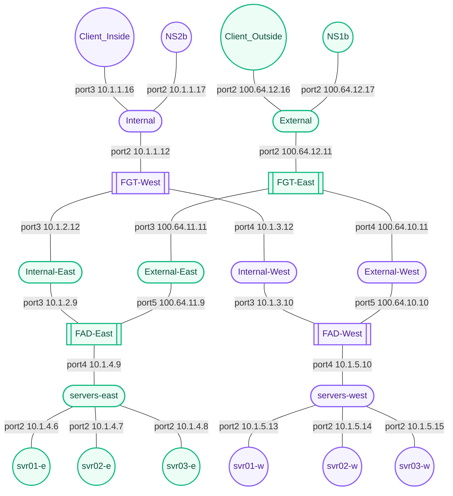

### Lab Network Diagram



### Device Access

1. Log into the **US Sunnyvale IPsec VPN**.



2. Using the link your instructor sent you, go to the evoke admin page
3. Click **Edit**



On this page you see **External IP Addresses**, **Internal IP Addresses**, **Credential** access etc...

To access any of the clients use the spice console in the far right.
To reach the FortiADC's use the **External IP**.



| Device Name     | Username       | Password       | 
|-----------------|----------------|----------------|
| FAD-East        | ```admin```    | ```fortinet``` |
| FAD-West        | ```admin```    | ```fortinet``` |
| Client_Inside   | ```fortinet``` | ```fortinet``` |
| Client_Outside  | ```fortinet``` | ```fortinet``` |

### Set screen resolution on Lubuntu

1. Click in the lower left corner to open the **Application Menu**
2. In the search field type **Monitor**
3. Select **Monitor Settings**
4. Set the screen resoltion to **1600x900**
5. Click **Apply**
6. Click **Save**
7. **Close**




