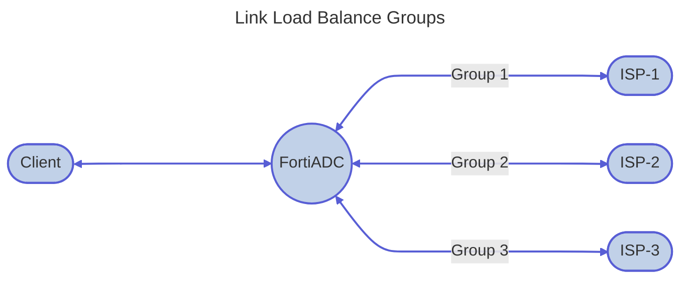

### Link load balancing
The link load balancing (LLB) features are designed to manage traffic over multiple internet service provider (ISP) or wide area network (WAN) links. This enables you to subscribe to or provision multiple links, resulting in reduced risk of outages, additional bandwidth for peak events, and potential cost savings if your ISP uses billing tiers based on bandwidth rate or peak/off-peak hours.

In most cases, you configure link load balancing for outgoing traffic. Outbound traffic might be user or server traffic that is routed from your local network through your ISP transit links, leased lines, or other WAN links to destinations on the Internet or WAN. You configure link policies that select the gateway for outbound traffic.

When the FortiADC system receives outbound traffic that matches a source/destination/service tuple that you configure, it forwards it to an outbound gateway link according to system logic and policy rules that you specify.

The LLB feature supports load balancing among link groups or among virtual tunnel groups.

The configuration of the gateway objects includes health checks and bandwidth thresholds. The configuration of link groups includes load balancing methods, persistence rules, and proximity routes.

**The FortiADC system evaluates traffic to determine the routing rules to apply. With regard to link load balancing, the system evaluates rules in the following order and applies the first match:**
- LLB link policy
- Policy route
- Static/Dynamic route
- LLB default link group

**Using link groups**

The link group option is useful for ISP links. It enables you to configure multiple ISP links that are possible routes for the traffic. The LLB picks the best route based on health checks, LLB algorithms, bandwidth rate thresholds, and other factors you specify, including a schedule.

LLB link groups shows an example topology when FortiADC is deployed to support link groups.



> [!info]
> If this feature is not visible in the GUI navigation menu, you may need to enable it under System > Feature Visibility.

> [!details]- ### Configure FAD-East
>
>### FAD-East
>
>**From the evoke admin console, look for the External IP for FAD-East:**
>
>
>
>**Log in with:**
>
>**Username:** ```admin``` 
> 
>**Password:** ```fortinet```
>
>1. Go to **Link Load Balance > Link Group** and click **Gateway**
>2. Click **Create New**
>
>
>
>**Add the Gateway for FGT-East:**
>
>3. Configure the **Name** ```FGT-East```
>4. Configure the **Address** ```100.64.11.254```
>5. Toggle the **Health Check** flag to **ON**
>6. Add the **LB_HLTHCK_ICMP** Health Check to the Health Check List
>
>
>
>7. **Save**
>
>
>
>**Add the Gateway for FGT-West:**
>
>8. Click **Create New**
>9. Configure the **Name** ```FGT-West```
>10. Configure the **Address** ```10.1.2.254```
>11. Toggle the **Health Check** flag to **ON**
>12. Add the **LB_HLTHCK_ICMP** Health Check to the Health Check List
>
>
>
>13. **Save**
>
>
>
>14. Go to **Link Load Balance > Link Group**
>15. Click **Create New**
>
>
>
>16. Configure the **Name** ```Link-Group1```
>17. Click **Save**
>18. Click **Create New**
>
>
>
>**Add the Link Members:**
>
>19. Configure the **Name** ```FGT-East```
>20. **Save**
>21. Select the Gateway **Click to Select**
>22. Add the Gateway **FGT-East**
>
>
>
>23. Click **Save**
>24. Repeat for **FGT-West** and **Save**
>
>
>
>25. Click **Save** again.
>
>
>
>26. Go to **Link Load Balance > Link Policy**
>27. Add your **Link Group** to the **Default Link Group**
>
>
>
>28. **Save**
>
>
>
>### FortiView Logical Topology
>
>Go to **FortiView > Logical Topology** and click the **Link Load Balance** Tab
>
>If everything is working properly your Link Group and Gateways will be green.
>
>

> [!details]- ### Configure FAD-West
>
>### FAD-West
>
>**From the evoke admin console, look for the External IP for FAD-West:**
>
>
>
>**Log in with:**
>
>**Username:** ```admin``` 
> 
>**Password:** ```fortinet```
>
>1. Go to **Link Load Balance > Link Group** and click **Gateway**
>2. Click **Create New**
>
>
>
>**Add the Gateway for FGT-East:**
>
>3. Configure the **Name** ```FGT-East```
>4. Configure the **Address** ```100.64.10.254```
>5. Toggle the **Health Check** flag to **ON**
>6. Add the **LB_HLTHCK_ICMP** Health Check to the Health Check List
>
>
>
>7. **Save**
>
>
>
>**Add the Gateway for FGT-West:**
>
>8. Click **Create New**
>9. Configure the **Name** ```FGT-West```
>10. Configure the **Address** ```10.1.3.254```
>11. Toggle the **Health Check** flag to **ON**
>12. Add the **LB_HLTHCK_ICMP** Health Check to the Health Check List
>
>
>
>13. **Save**
>
>
>
>14. Go to **Link Load Balance > Link Group**
>15. Click **Create New**
>
>
>
>16. Configure the **Name** ```Link Group1```
>17. Click **Save**
>18. Click **Create New**
>
>
>
>**Add the Link Members:**
>
>19. Configure the **Name** ```FGT-East```
>20. **Save**
>21. Select the Gateway **Click to Select**
>22. Add the Gateway **FGT-East**
>
>
>
>23. Click **Save**
>24. Repeat for **FGT-West** and **Save**
>
>
>
>25. Click **Save** again.
>
>
>
>26. Go to **Link Load Balance > Link Policy**
>27. Add your **Link Group** to the **Default Link Group**
>
>
>
>28. **Save**
>
>
>
>### FortiView Logical Topology
>
>Go to **FortiView > Logical Topology** and click the **Link Load Balance** Tab
>
>If everything is working properly your Link Group and Gateways will be green.
>
>

**Configuration Guidelines**

1. Add address, address group, service, service group, and schedule group configuration objects that can be used to match traffic to link policy rules. This step is recommended. If your policy does not use match criteria, it will not have granularity.
2. Configure optional features. If you want to use health check rules, configure them before you configure the gateway links. If you want to use persistence rules or proximity routes, configure them before you configure a link group.
3. Configure gateway links.
4. Configure link groups or virtual tunnels.
5. Configure the link policy. When you configure a link policy, you set the source/destination/service matching tuple for your link groups or virtual tunnels. 