### Server

**Configuring servers**
In the context of the global server load balance configuration, servers are the local SLB (FortiADC instances or third-party servers) to be load balanced. For FortiADC instances, the GLB checks status and synchronizes configuration from the local SLB so that it can learn the set of virtual servers that can be included in the GLB virtual server pool.

Virtual server discovery illustrates configuration discovery. Placement in this list does not include them in the pool. You also must name them explicitly in the virtual server pool configuration.

Virtual server discovery

```mermaid
graph RL
    %% Global FortiADC Representation
    subgraph Global["Global Load Balance"]
    
    
    
        direction TB
        Client("Local SLB Discovery")
        GLB("TCP Port 5858")
        
        subgraph ChinaServer[China]
            direction TB
            M1(FortiADC China)
            M1 --> VS1_C("Virtual Server IP Address")
            M1 --> VS2_C("Virtual Server IP Address")
            M1 --> VS3_C("Virtual Server IP Address")
        end
        subgraph EuropeServer[Europe]
            direction TB
            M3(FortiADC Europe)
            M3 --> VS1_Z("Virtual Server IP Address")
            M3 --> VS2_Z("Virtual Server IP Address")
            M3 --> VS3_Z("Virtual Server IP Address")
        end
       
        subgraph USServer[US]
            direction TB
            M2(FortiADC US)
            M2 --> VS1_U("Virtual Server IP Address")
            M2 --> VS2_U("Virtual Server IP Address")
            M2 --> VS3_U("Virtual Server IP Address")
        end

        Client --> GLB
        GLB --> EuropeServer
        GLB --> ChinaServer
        GLB --> USServer
    end

    %% Local FortiADC Clusters
    subgraph LocalChina["Local FortiADC - China"]
        direction TB
        LVS1_C("Virtual Server")
        LVS2_C("Virtual Server")
        LVS3_C("Virtual Server")
    end

    subgraph LocalUS["Local FortiADC - US"]
        direction TB
        LVS1_U("Virtual Server")
        LVS2_U("Virtual Server")
        LVS3_U("Virtual Server")
    end
    
    subgraph LocalEurope["Local FortiADC - Europe"]
        direction TB
        LVS1_Z("Virtual Server")
        LVS2_Z("Virtual Server")
        LVS3_Z("Virtual Server")
    end

    %% Interactions
    Global == SLB Discovery ===> LocalUS
    LocalUS ==> Global
    Global == SLB Discovery ===> LocalChina
    LocalChina ==> Global
    Global == SLB Discovery ===> LocalEurope
    LocalEurope ==> Global

    %% Change all lines to white
    linkStyle 0 stroke:#000,stroke-width:3px;
    linkStyle 1 stroke:#000,stroke-width:3px;
    linkStyle 2 stroke:#000,stroke-width:3px;
    linkStyle 3 stroke:#000,stroke-width:3px;
    linkStyle 4 stroke:#000,stroke-width:3px;
    linkStyle 5 stroke:#000,stroke-width:3px;
    linkStyle 6 stroke:#000,stroke-width:3px;
    linkStyle 7 stroke:#000,stroke-width:3px;
    linkStyle 8 stroke:#000,stroke-width:3px;
    linkStyle 9 stroke:#000,stroke-width:3px;
    linkStyle 10 stroke:#000,stroke-width:3px;
    linkStyle 11 stroke:#000,stroke-width:3px;
    linkStyle 12 stroke:#000,stroke-width:3px;
    linkStyle 13 stroke:#000,stroke-width:3px;
    linkStyle 14 stroke:#000,stroke-width:3px;
    
    %% Styling
    style Global fill:#C1D1E8,stroke:#111,stroke-width:2px,color:#000,rx:20px,ry:20px
    style ChinaServer fill:#D8E1ED,stroke:#111,color:#000,rx:20px,ry:20px
    style USServer fill:#D8E1ED,stroke:#111,color:#000,rx:20px,ry:20px
    style LocalChina fill:#D8E1ED,stroke:#111,stroke-width:2px,color:#000,rx:20px,ry:20px
    style LocalUS fill:#D8E1ED,stroke:#111,stroke-width:2px,color:#000,rx:20px,ry:20px
    style EuropeServer fill:#D8E1ED,stroke:#111,color:#000,rx:20px,ry:20px
    style LocalEurope fill:#D8E1ED,stroke:#111,stroke-width:2px,color:#000,rx:20px,ry:20px
    style GLB fill:#fff,stroke:#111,color:#000
    style Client fill:#fff,stroke:#111,color:#000
    style VS1_C fill:#fff,stroke:#111,color:#000
    style VS2_C fill:#fff,stroke:#111,color:#000
    style VS3_C fill:#fff,stroke:#111,color:#000
    style M1 fill:#fff,stroke:#111,color:#000
    style VS1_Z fill:#fff,stroke:#111,color:#000
    style VS2_Z fill:#fff,stroke:#111,color:#000
    style VS3_Z fill:#fff,stroke:#111,color:#000
    style M3 fill:#fff,stroke:#111,color:#000
    style VS1_U fill:#fff,stroke:#111,color:#000
    style VS2_U fill:#fff,stroke:#111,color:#000
    style VS3_U fill:#fff,stroke:#111,color:#000
    style M2 fill:#fff,stroke:#111,color:#000
    
    style LVS1_C fill:#fff,stroke:#111,stroke-width:2px,color:#000
    style LVS2_C fill:#fff,stroke:#111,stroke-width:2px,color:#000
    style LVS3_C fill:#fff,stroke:#111,stroke-width:2px,color:#000
    style LVS1_U fill:#fff,stroke:#111,stroke-width:2px,color:#000
    style LVS2_U fill:#fff,stroke:#111,stroke-width:2px,color:#000
    style LVS3_U fill:#fff,stroke:#111,stroke-width:2px,color:#000
    style LVS1_Z fill:#fff,stroke:#111,stroke-width:2px,color:#000
    style LVS2_Z fill:#fff,stroke:#111,stroke-width:2px,color:#000
    style LVS3_Z fill:#fff,stroke:#111,stroke-width:2px,color:#000

```



**Before you begin:**
- You must have created the data center configuration objects that are associated with the local SLB.
- You must have created virtual server configurations on the local FortiADC SLB. In this procedure, the global SLB discovers them.
- You must have created gateway configuration objects on the local FortiADC SLB if you want to configure a gateway health check. In this procedure, the global SLB discovers them.
- You must have created an SDN connector configuration. Note: Currently, the SDN Connector option only supports AWS Connectors
- You must have Read-Write permission for Global Load Balance settings.
After you have created a server configuration object, you can specify it in the global load balancing virtual server pool configuration.

> [!details]- ### Configure FAD-East
>
>### FAD-East
>
>**From the evoke admin console, look for the External IP for FAD-East:**
>
>
>
>**Log in with:**
>
>**Username:** ```admin``` 
> 
>**Password:** ```fortinet```
>
>1. Go to **Global Load Balance > GLB Configuration**
>2. Click the **Server** tab.
>3. Click **Create New** to display the configuration editor.
>4. Configure the **Name** ```FAD-East```
>5. Configure the **IP Address** ```192.168.0.4```
>6. Select the corresponding **Data Center** <mark>Datacenter-East</mark>
>7. Set the **Auto Sync** toggle to **ON**
>8. **Save**
>
>
>
>9. Click **Save**
>10. Click **Refresh**
>
>
>
>11. Click the pencil icon to update the **Gateway Status** for each **Member**
>
>
>
>12. Click **or Select Here** to select the corresponding Gateway **FGT-East**
>
>
>
>13. **Save**
>
>
>
>14. Click **Save** again
>
>15. Repeat the process and add the **FAD-West** Server
> 
>

> [!details]- ### Configure FAD-West
>
>### FAD-West
>
>**From the evoke admin console, look for the External IP for FAD-West:**
>
>
>
>**Log in with:**
>
>**Username:** ```admin``` 
> 
>**Password:** ```fortinet```
>
>1. Go to **Global Load Balance > GLB Configuration**
>2. Click the **Server** tab.
>3. Click **Create New** to display the configuration editor.
>4. Configure the **Name** ```FAD-West```
>5. Configure the **IP Address** ```192.168.0.5```
>6. Select the corresponding **Data Center** <mark>Datacenter-West</mark>
>7. Set the **Auto Sync** toggle to **ON**
>8. **Save**
>
>
>
>9. Click **Save**
>10. Click **Refresh**
>
>
>
>11. Click the pencil icon to update the **Gateway Status** for each **Member**
>
>
>
>12. Click **or Select Here** to select the corresponding Gateway **FGT-West**
>
>
>
>13. **Save**
>
>
>
>14. Click **Save** again
>
>15. Repeat the process and add the **FAD-East** Server
>
>

**Configuration Guidelines**

| Setting                       | Description                                                                                                                                                                                                                                                                                                                                                                                                                                                                                                                                                                                                                          |
|-------------------------------|--------------------------------------------------------------------------------------------------------------------------------------------------------------------------------------------------------------------------------------------------------------------------------------------------------------------------------------------------------------------------------------------------------------------------------------------------------------------------------------------------------------------------------------------------------------------------------------------------------------------------------------|
| Name                          | 	Configuration name. Valid characters are A-Z, a-z, 0-9, _, and -. No spaces. You reference this name in the global load balance servers configuration.<br>**Note:** After you initially save the configuration, you cannot edit the name.                                                                                                                                                                                                                                                                                                                                                                                            |
| Type                          | Select the remote server to use for global server load balancing:<br><br>**FortiADC SLB:** use a FortiADC instance. <br>**Generic Host:** use a third party ADC or server. <br>**SDN Connector:** use an existing external connector that is connected to the FortiADC Security Fabric.<br><br>**Note:** Currently, the SDN Connector option only supports AWS Connectors.                                                                                                                                                                                                                                                           |
| Auth Type                     | The Auth Type option is available if Type is FortiADC SLB.<br><br>Select the authentication type:<br><br>**None:** No password.<br>**TCP MD5SIG:** With password, but cannot be used if NAT is in between the client and server. This is because, when using the TCP MD5SIG authentication in a network with NAT in between, the IP layer is encrypted. So is every packet. Because the IP address will be changed, the encryption check will always fail.<br>**Auth Verify:** The authentication key is sent to the server after a three-way handshake. The key is encrypted and NAT in between will not affect the authentication. |
| Password                      | The Password option is available if Type is FortiADC SLB and Auth Type is TCP MD5SIG.<br>Enter the password to authenticate the key.<br>The password you enter here must match the password configured on the FortiADC appliance in a global sever load-balancing configuration.                                                                                                                                                                                                                                                                                                                                                     |
| User Defined Certificate      | The User Defined Certificate option is available if Type is FortiADC SLB.<br>Enable to use a self-defined certificate for authentication.                                                                                                                                                                                                                                                                                                                                                                                                                                                                                            |
| Certificate                   | The Certificate option is available if Type is FortiADC SLB and User Defined Certificate is enabled.<br>Select the local certificate object to use for the GSLB server.                                                                                                                                                                                                                                                                                                                                                                                                                                                              |
| CA Verifiy                    | The CA Verify option is available if Type is FortiADC SLB is enabled.<br>Enable to require certificate validation when establishing TLS sessions with the SLB. When enabled, the GLB validates the SLB's certificate chain against the configured CA and intermediate CA groups.                                                                                                                                                                                                                                                                                                                                                     |
| Trusted CA Group              | The Trusted CA Group option is available if CA Verify is enabled.<br>Select a trusted CA group to verify the peer certificate.                                                                                                                                                                                                                                                                                                                                                                                                                                                                                                       |
| Trusted Intermediate CA Group | The Trusted Intermediate CA Group option is available if CA Verify is enabled.<br>Select a trusted intermediate CA group to verify the peer certificate.                                                                                                                                                                                                                                                                                                                                                                                                                                                                             |
| Address Type                  | The Address Type option is available if Type is FortiADC SLB.<br>IPv4 or IPv6.                                                                                                                                                                                                                                                                                                                                                                                                                                                                                                                                                       |
| IP Address/IPv6 Address       | The IP Address or IPv6 Address option is available if Type is FortiADC SLB.<br>Specify the IPv4 or IPv6 address for the FortiADC management interface. This IP address is used for synchronization and also status checks. If the management interface is unreachable, the virtual servers for that FortiADC are excluded from DNS responses.                                                                                                                                                                                                                                                                                        |
| Port                          | The Port option is available if Type is FortiADC SLB.<br>Specify the port. Default: 5858 Range: 1-65535.                                                                                                                                                                                                                                                                                                                                                                                                                                                                                                                             |
| SDN Connector                 | The SDN Connector option is available if Type is SDN Connector.<br>Select the SDN Connector to synchronize to the GSLB server. For public SDN type servers, GSLB can update the public IP dynamically. Note: Currently, only AWS connectors are supported.                                                                                                                                                                                                                                                                                                                                                                           |
| Use SDN Private IP            | The Use SDN Private IP option is available if Type is SDN Connector.<br>Enable to use the SDN Private IP address.                                                                                                                                                                                                                                                                                                                                                                                                                                                                                                                    |
| Data Center                   | 	Select a data center configuration object. The data center configuration object properties are used to establish the proximity of the servers and the client requests.                                                                                                                                                                                                                                                                                                                                                                                                                                                               |
| Auto-sync                     | Enable/disable automatic synchronization with the remote server. When enabled, Global load balancing will synchronize automatically with the server member.<br>If auto-sync is enabled for SDN Connector type servers, all instances from the SDN connector will be added as server members.<br>**Note:** When disabling auto-sync, the server member will be cleared and re-synced.                                                                                                                                                                                                                                                 |
| Health Check Control          | The Health Check Control option is available if Type is Generic Host or SDN Connector.<br>Enable/disable health checks for the virtual server list. The health check settings at this configuration level are the parent configuration. When you configure the list, you can specify whether to inherit or override the parent configuration.<br>**Note:** Health checking is built-in, and you can optionally configure a gateway health check.                                                                                                                                                                                     |
