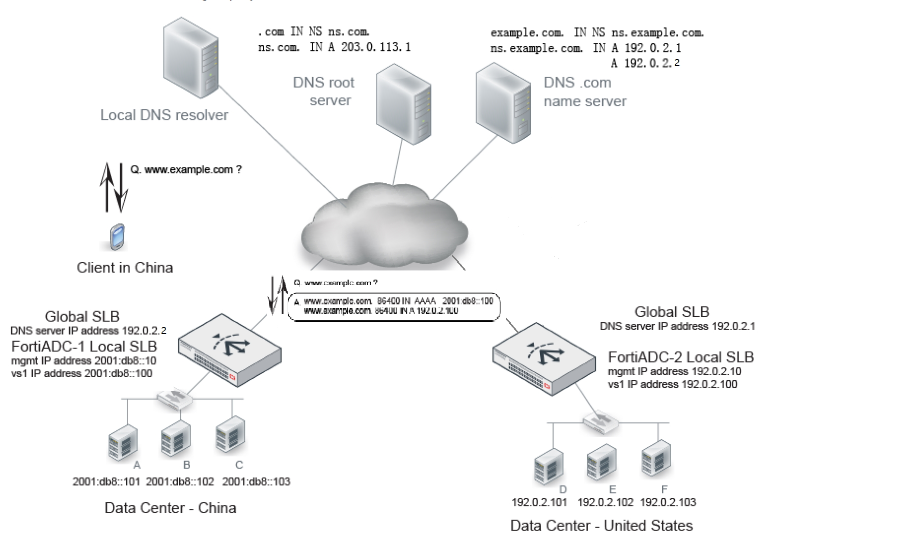
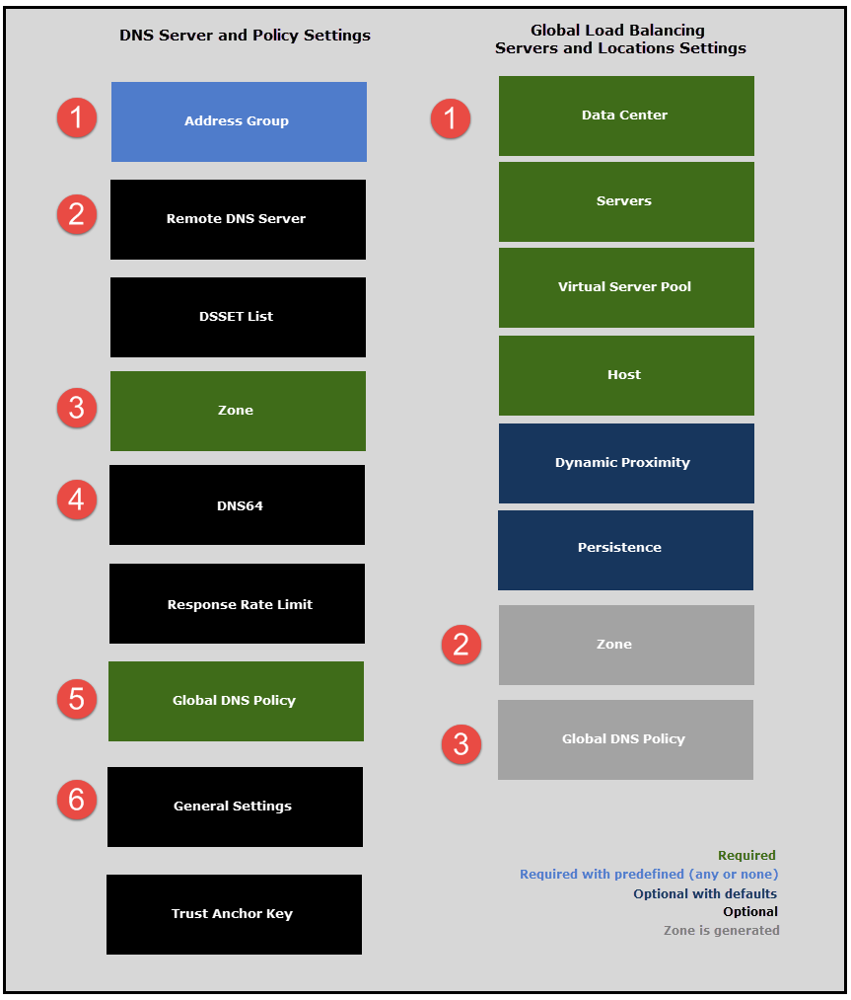

### Global Load Balance

The Global Load Balance (GLB) module is the architectural framework that ensures business continuity and application performance across a distributed global infrastructure. While local load balancing optimizes traffic within a single data center, GLB operates at the DNS level to manage traffic across multiple geographic regions. By acting as an authoritative name server, FortiADC intelligently directs users to the most appropriate data center based on real-time health, geographic proximity, and network conditions. This global steering capability eliminates regional single points of failure and ensures a seamless user experience even during large-scale outages or maintenance windows.

### Global Load Balancing Overview

Global Load Balancing in FortiADC works by responding to DNS queries with the most optimal IP address for a given client. Instead of providing a static response, the GLB engine evaluates the global landscape before answering.

**This process improves global application delivery in several ways:**

- **Disaster Recovery** - Continuous global health monitoring ensures that if an entire data center becomes unreachable, traffic is automatically diverted to a redundant site in another region.
- **Latency Reduction** - By directing users to the data center physically closest to them (Geo-Proximity) or the one with the fastest response time (RTT), GLB significantly reduces the distance data must travel.
- **Traffic Distribution** - Administrators can balance global demand across multiple regions to prevent any single data center from becoming overwhelmed by regional traffic spikes.
- **Security and Integrity** - FortiADC protects the naming infrastructure by implementing DNSSEC to prevent cache poisoning and Response Rate Limiting to mitigate DNS-based DDoS attacks.

### Core Modules of Global Load Balance

**The GLB framework is built on a modular architecture, organized into specialized modules to manage global traffic steering and DNS security:**

- **GLB Onboarding** - The GLB Wizard provides a streamlined interface to simplify and accelerate the deployment of the global load balancing environment. It automates the initial creation and association of data centers, servers, and pools to establish a functional framework. This tool is designed for efficient setup, while the GLB Configuration module remains available for users who require manual, granular adjustments to individual components.

- **GLB Configuration** - Manual definition and management of the global infrastructure take place within this module. It serves as the primary repository for the physical and logical building blocks of the network, including Hosts (FQDNs), Virtual Server Pools, Data Centers, and the Servers (FortiADC or third-party) that host applications worldwide.

- **Zone and DNS Security** - Authoritative DNS zones and the security policies that protect them are managed through this module. It handles the Global DNS Policy used to steer traffic and houses Security Settings for advanced protections like DNSSEC and encrypted transport (DoH and DoT). It also includes Response Rate Limiting to defend the infrastructure against malicious high-volume queries.

- **Global DNS Setting** - Baseline operational behaviors of the DNS engine are defined in this module. It provides the controls for core parameters such as recursion and interface listening, as well as DNS64 for IPv6-to-IPv4 compatibility and Address Groups for organizing network objects used in policy enforcement.

- **Global Traffic Steering Logic** - The FortiADC system implements a hardened BIND 9 DNS server that acts as the authoritative name server for your configured zones. In this framework, zone resource records are generated dynamically based on global load balancing logic rather than static entries. When a client sends a DNS query, the FortiADC returns an ordered list of answers. According to standard DNS resolver behavior, the client attempts to connect to the first address in the list and only proceeds to the subsequent answers if the previous answer is unreachable. 

**The system determines the priority and position of these answers based on the following hierarchy:**

| Priority | Steering Logic | Description |
|----------|----------------|-------------|
| 1 | Virtual Server Health | The system performs real-time connectivity checking. Any server identified as unavailable is excluded from the response list entirely. |
| 2 | Persistence | If the application requires session affinity, a match in the persistence table takes precedence over proximity to ensure the user returns to the same host. |
| 3 | Geographic Proximity | The system matches the client source IP to either the FortiGuard Geo IP database or a predefined ISP address book to identify the closest physical resource. |
| 4 | Dynamic Proximity | Performance is calculated using real-time metrics such as RTT probes (application response time), least connections, or data throughput (bytes per second). |
| 5 | Weighted Round Robin | This is the fallback algorithm. If no other logic is applicable, servers are ordered based on a simple weight-based distribution. |

**Example: Redundant Global Deployment**

Consider a deployment with redundant resources located in data centers in China and the United States (see Global load balancing deployment). In this scenario, two FortiADC units (FortiADC-1 in China and FortiADC-2 in the United States) function as the local load balancers for their respective sites while simultaneously acting as the Global Server Load Balancers (GSLB).

These units host the authoritative DNS servers for a specific domain, such as www.example.com. When a client initiates a request, the local host DNS resolver commences a query that is ultimately resolved by the authoritative DNS server on the FortiADC units. 

**The GLB framework then evaluates the request:**
- **Proximity Steering** - The framework uses health status and proximity algorithms to determine the set of answers. For example, a client located in China is directed to the local China virtual server to minimize latency.
- **Failover Logic** - If the virtual server in China becomes unavailable, the GLB engine identifies the failure via real-time health checks. It then excludes the failed server and directs the client to the redundant resources in the United States.

**Global load balancing deployment**

**DNS Security and Deployment Connectivity**

**To ensure the global naming service is both secure and functionally integrated with local resources, the FortiADC utilizes the following features:**
- **Automated Discovery** - Configuration is performed only on the global FortiADC instances. These global units automatically discover virtual server IP addresses and ports from local units to use in DNS responses. The system also supports third-party IP addresses and independent health checks for external resources.
- **DNSSEC (Domain Name System Security Extensions)** - This provides authentication by associating cryptographically generated digital signatures with DNS resource record sets. The system simplifies the management of keys provided to parent domains and those imported from child domains.
- **Response Rate Limit** - This helps mitigate DNS denial of service attacks by reducing the rate at which authoritative name servers respond to high volumes of malicious or suspicious queries.
- **DNS Forwarding** - The FortiADC can answer requests for internal resources directly from zone data while sending requests for remote resources to a forwarder. The system caches these results to optimize subsequent lookups and minimize direct communication with internet DNS servers.

**Global load balancing configuration summary**

**Basic steps (DNS server)**
- Configure address groups to use in your DNS policy matching rules. The system includes the predefined address groups any and none.
- Configure remote DNS servers (forwarders) and the DSSET list that you might reference in the zone configuration.
- Complete the zone configuration. The global load balancing framework generates the zone configuration for zones that include the FortiADC virtual servers.
- Configure DNS64 or response rate limit configurations that you might reference in the DNS policy.
- Configure the DNS policy that matches a source/destination tuple to a zone. You can also enable and configure DNSSEC in the DNS policy.
- Configure general DNS settings to be applied when DNS requests do not match the DNS policy.

**Basic steps (Global load balancing)**
- Create the data center, servers, virtual server pool, and host configurations that are the framework for associating locations with virtual servers and generating the DNS zone configuration and resource records. You can adjust the dynamic proximity and persistence settings at any time.
- Review the generated DNS zone configuration.
- Create a policy that matches traffic to the generated zone configuration.

